# OpenRGB Remote (Android)

*[English](README.md) · Deutsch*

Inoffizieller, moderner Android-Client für den [OpenRGB](https://openrgb.org) SDK Server.
Er steuert RGB-Beleuchtung an PCs im Netzwerk, auf denen OpenRGB mit aktiviertem SDK-Server
läuft (Standardport **6742**).

> ⚠️ **Sicherheit:** Der OpenRGB SDK Server hat keine Authentifizierung. Nutze ihn nur im
> vertrauenswürdigen LAN oder über ein VPN und gib Port 6742 nie ins Internet frei.

## Stand

| Schritt | Status |
|---|---|
| 1. Architektur & Projektstruktur | ✅ [`docs/ARCHITECTURE.de.md`](docs/ARCHITECTURE.de.md) |
| 2a. Protokoll-Modul `:openrgb-sdk` (v0–6, Reconnect, Backpressure, Scan) | ✅ |
| 2b. Verbindungen, Netzwerk-Scan, Geräteliste, Detailansicht, Onboarding (App) | ✅ |
| 2c. Farbsteuerung (Farbrad, HSV, Hex, Favoriten, Ziele, Live-Vorschau) und Hardware-Modi | ✅ |
| 2d. Profile (8 vorgefertigte, eigene, Duplizieren, JSON-Import/-Export, global oder pro Gerät) | ✅ |
| 2e. Effekt-Engine (8 Effekte inkl. Musik), Foreground-Service, Effekte-Tab | ✅ |
| 2f. Favoriten-Widget, 3 Schnelleinstellungs-Kacheln, Zeitpläne, Barrierefreiheits-Prüfung | ✅ |
| 2g. Animierte Profile (Effekte in Profilen), Effekt-Einstellungen bleiben über Neustarts erhalten | ✅ |
| 2h. CI: Tests, Lint, Debug- und Release-APK, GitHub-Releases | ✅ [](https://github.com/2eno/OpenRGB-Android/actions/workflows/build.yml) |
| 2i. SSH-Jump-Host (App-Schlüssel oder Passwort, festgehaltener Host-Key, eingeschränkter Tunnel) | ✅ |

## Screenshots

Gerendert von den Robolectric-Screenshot-Tests (`app/src/test/.../ScreenshotTest.kt`). Die Gerätedaten
stammen aus echten Paketen eines OpenRGB-1.0-Servers; die Farben sind zur Demonstration gesetzt,
weil Debug-Geräte alle LEDs als schwarz melden.

| Geräte | Detail (Tastatur-Matrix) | Onboarding: Verbinden | Fehlermeldung |
|---|---|---|---|
| 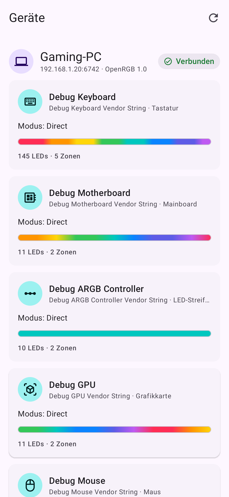 | 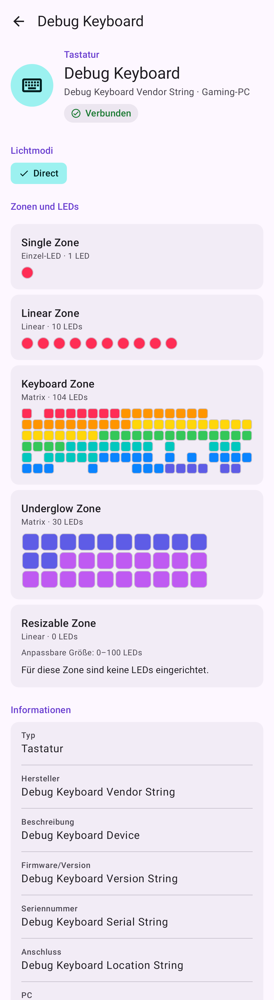 | 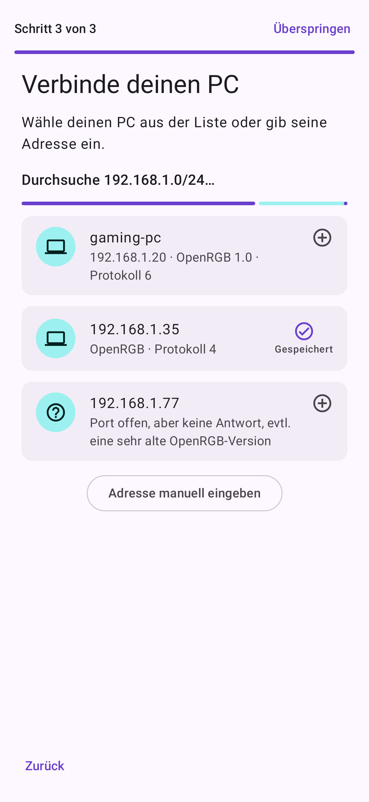 | 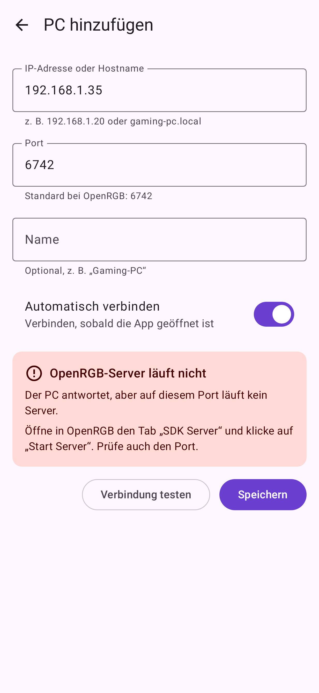 |

| Farbsteuerung | Hardware-Modus |
|---|---|
| 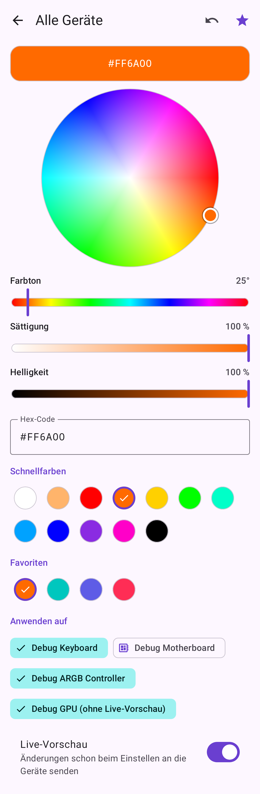 | 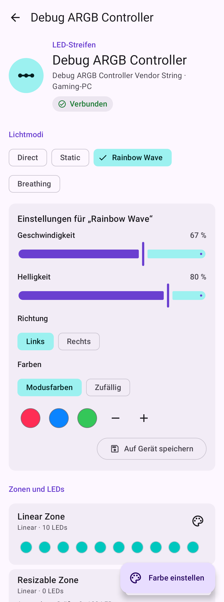 |

| Profile | Profil-Editor | Animiertes Profil |
|---|---|---|
| 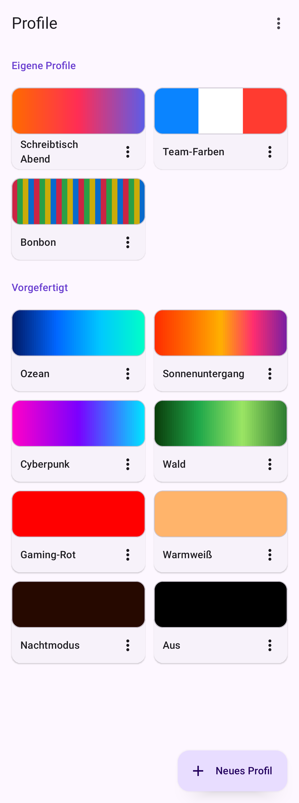 | 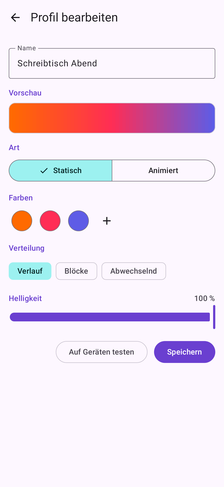 | 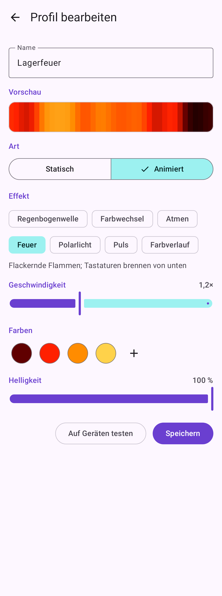 |

| Effekte | Effekt-Einstellungen | Laufender Effekt in der Geräteliste |
|---|---|---|
| 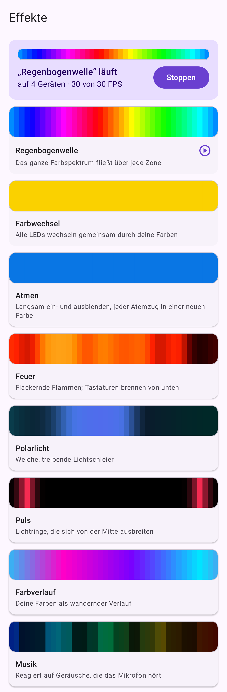 | 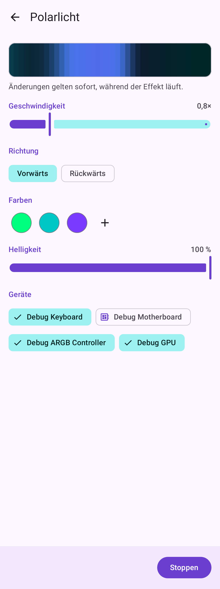 | 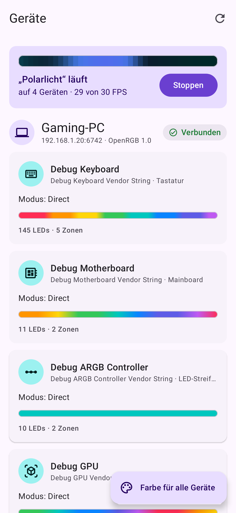 |

| Favoriten (Widget & Kacheln) | Zeitpläne | Zeitplan-Editor | Große Schrift (200 %) |
|---|---|---|---|
| 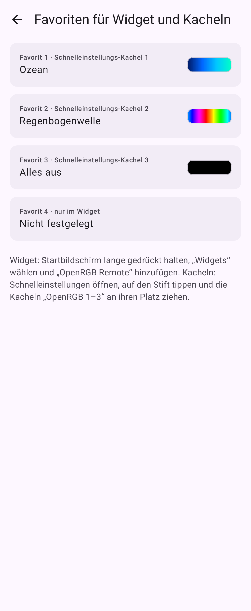 | 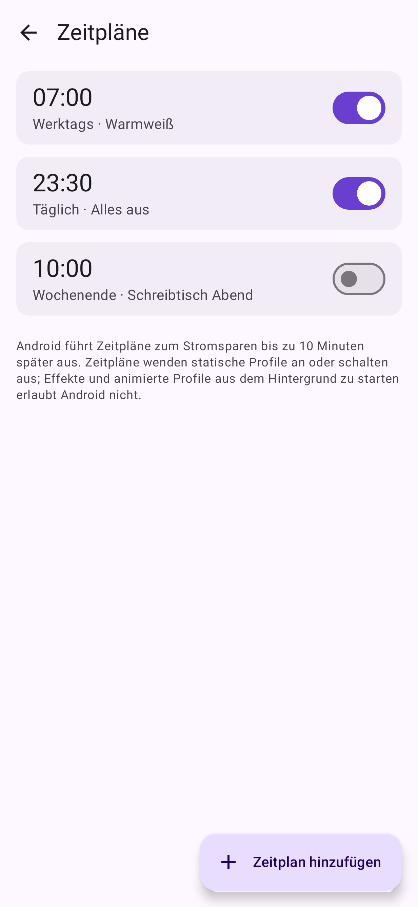 | 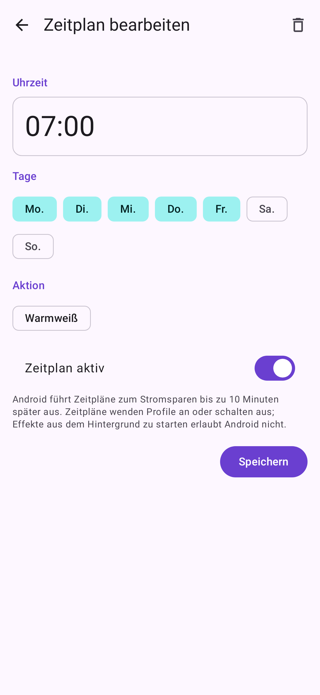 | 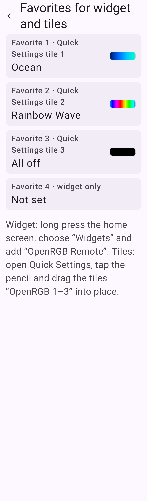 |

| SSH-Jump-Host | Fingerabdruck bestätigen |
|---|---|
| 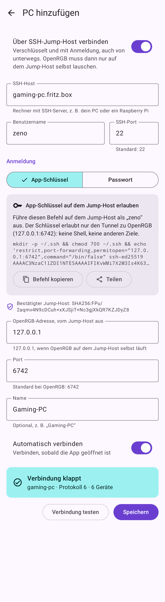 | 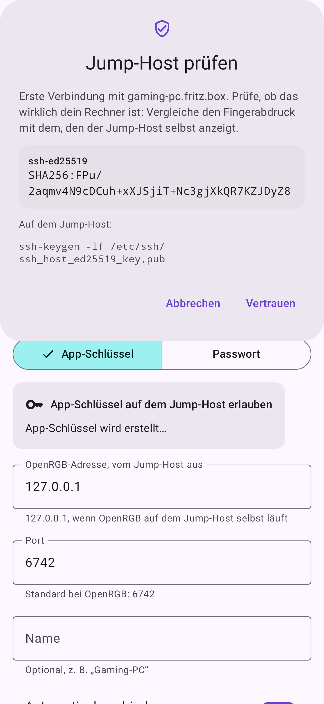 |

Tablet: 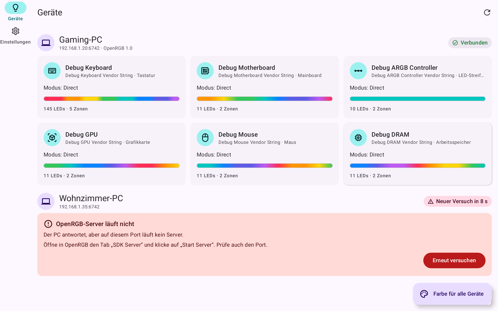 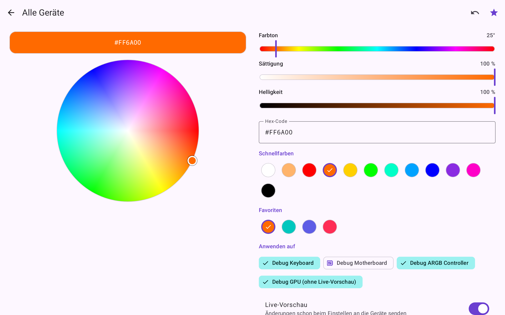

## OpenRGB auf dem PC starten

OpenRGB 1.0 bindet den SDK-Server ohne weitere Angabe an **127.0.0.1**, das Handy erreicht ihn dann nicht.

* **Mit Desktop:** In OpenRGB im Tab „SDK Server“ „Server Host“ auf `0.0.0.0` setzen und „Start
  Server“ klicken. `"Server": {"default_host": "0.0.0.0"}` in `~/.config/OpenRGB/OpenRGB.json`
  speichert das dauerhaft.
* **Ohne Display** (headless, per SSH): `openrgb --server --server-host 0.0.0.0`.
  Kein `--startminimized` anhängen: Das startet die GUI und bricht mit
  „could not connect to display“ / „Qt platform plugin xcb“ ab.
* **Über einen SSH-Jump-Host** (verschlüsselt, mit Anmeldung, auch von unterwegs): Das sicherere
  `openrgb --server` reicht, denn die App verbindet sich auf dem Jump-Host mit 127.0.0.1. In der App
  beim Hinzufügen des PCs „Über SSH-Jump-Host verbinden“ einschalten.

* **Android 17:** Die App fragt nach „Geräte in der Nähe“ (lokales Netzwerk). Ohne diese
  Berechtigung laufen Verbindungen zum PC nur in einen Timeout, auch wenn andere Apps (z. B. Termux)
  ihn erreichen.

Als Dienst, der mit der Benutzersitzung startet (`~/.config/systemd/user/openrgb.service`):

```ini
[Unit]
Description=OpenRGB SDK server

[Service]
# "--server-host 0.0.0.0" weglassen, wenn die App über einen SSH-Jump-Host verbindet.
ExecStart=/usr/bin/openrgb --server --server-host 0.0.0.0 --noautoconnect
Restart=on-failure

[Install]
WantedBy=default.target
```

`systemctl --user enable --now openrgb`; auf einem Rechner, an dem sich niemand anmeldet, zusätzlich
`loginctl enable-linger $USER`. Die meisten Geräte brauchen die udev-Regeln von OpenRGB (openrgb.org/udev).

## Bauen & Testen

Voraussetzungen: JDK 17+, Android SDK (Plattform 37) mit `ANDROID_HOME` oder `local.properties`.
Der Gradle-Wrapper lädt Gradle 9.9 automatisch.

```bash
./gradlew :app:assembleDebug                      # APK
./gradlew unitTests                               # alle Unit-Tests (Debug-Varianten)
./gradlew :app:lintDebug                          # Lint (Warnungen gelten als Fehler)
```

Die Screenshot-Tests schreiben PNGs nach `app/build/screenshots/`. Robolectric läuft offline:
seine Android-Laufzeit wird über Gradle aufgelöst (siehe `app/build.gradle.kts`).

Texte stehen in `tools/strings_app.py` (Englisch + Deutsch) und werden mit
`python3 tools/strings_app.py` nach `app/src/main/res/values*/strings.xml` generiert. So fehlt nie
ein Schlüssel in einer der Sprachen.

### Tests gegen einen echten OpenRGB-Server

```bash
# PC mit OpenRGB: "SDK Server" starten (GUI) oder headless:
openrgb --server --server-port 6742

OPENRGB_TEST_SERVER=192.168.1.20:6742 ./gradlew :openrgb-sdk:test
OPENRGB_TEST_SERVER=192.168.1.20:6742 ./gradlew :core:data:testDebugUnitTest
```

Der zweite Befehl enthält `RealServerEndToEndTest`: Die Datenschicht der App wendet Profile an und
lässt Effekte auf dem Server laufen, ein zweiter Client liest die Farben zurück. Er ändert die
Beleuchtung aller Geräte an diesem Server. Die beiden Befehle nacheinander ausführen, nicht in einem
Gradle-Aufruf: Gradle würde sie parallel starten, und der SDK-Test endet mit einem Hardware-Rescan,
der bei OpenRGB 1.0 alle LEDs zurücksetzt.

Über einen SSH-Jump-Host, z. B. mit OpenRGB auf dem Jump-Host an 127.0.0.1 gebunden:
`OPENRGB_TEST_SERVER=127.0.0.1:6742 OPENRGB_TEST_JUMP='user:passwort@pc.local:22' ./gradlew :core:data:testDebugUnitTest`
(optional `OPENRGB_TEST_JUMP_FINGERPRINT` mit der Ausgabe von `ssh-keygen -lf`).

### CI und Releases

`.github/workflows/build.yml` führt bei jedem Push die Unit-Tests und Lint aus und baut beide APKs;
sie hängen als Artefakt `apks` am Lauf. Ein Tag wie `v0.2.0` erzeugt zusätzlich ein GitHub-Release.
Für eine stabile Release-Signatur die Secrets `RELEASE_KEYSTORE_BASE64`,
`RELEASE_KEYSTORE_PASSWORD`, `RELEASE_KEY_ALIAS` und `RELEASE_KEY_PASSWORD` anlegen (Details in der
Workflow-Datei); ohne sie wird das Release-APK mit einem Wegwerf-Debug-Schlüssel signiert. Die
Debug-App („OpenRGB Debug“, `dev.eno2.openrgbremote.debug`) lässt sich neben dem Release installieren.

Die Fixtures unter `openrgb-sdk/src/testFixtures/resources/fixtures/openrgb-1.0` wurden mit
`tools/capture_fixtures.py` von einem OpenRGB-1.0-Server mit Debug-Geräten mitgeschnitten
(Anleitung im Skriptkopf).

## SDK-Beispiel

```kotlin
val client = OpenRgbClient("192.168.1.20")
client.connect()                                   // handelt Protokoll v0–6 aus
val keyboard = client.devices.value.first { it.type == DeviceType.KEYBOARD }
keyboard.directModeIndex()?.let { client.updateMode(keyboard.id, it, keyboard.modes[it]) }
client.updateLeds(keyboard.id, IntArray(keyboard.ledCount) { 0xFF0040 })
client.close()
```

Mit automatischem Reconnect: `OpenRgbConnection(host, port, scope).start()`.

## Lizenz-Hinweis

OpenRGB ist ein eigenständiges GPL-Projekt; diese App ist nicht damit verbunden. Das Protokoll
wurde anhand der öffentlichen SDK-Dokumentation implementiert; es wird kein OpenRGB-Code verwendet.
