# OpenRGB Remote (Android)

*English · [Deutsch](README.de.md)*

An unofficial, modern Android client for the [OpenRGB](https://openrgb.org) SDK server.
It controls RGB lighting on PCs in your network that run OpenRGB with the SDK server enabled
(default port **6742**).

> ⚠️ **Security:** the OpenRGB SDK server has no authentication. Only use it in a trusted LAN
> or over a VPN, and never expose port 6742 to the internet.

## Status

| Step | Status |
|---|---|
| 1. Architecture & project structure | ✅ [`docs/ARCHITECTURE.md`](docs/ARCHITECTURE.md) |
| 2a. Protocol module `:openrgb-sdk` (v0–6, reconnect, backpressure, scan) | ✅ |
| 2b. Connections, network scan, device list, detail view, onboarding (app) | ✅ |
| 2c. Color control (color wheel, HSV, hex, favorites, targets, live preview) and hardware modes | ✅ |
| 2d. Profiles (8 presets, custom, duplicate, JSON import/export, global or per device) | ✅ |
| 2e. Effects engine (8 effects incl. music), foreground service, Effects tab | ✅ |
| 2f. Favorites widget, 3 quick settings tiles, schedules, accessibility check | ✅ |
| 2g. Animated profiles (effects in profiles), effect settings kept across restarts | ✅ |
| 2h. CI: tests, lint, debug and release APKs, GitHub releases | ✅ [](https://github.com/2eno/OpenRGB-Android/actions/workflows/build.yml) |
| 2i. SSH jump host (app key or password, pinned host key, restricted tunnel) | ✅ |

## Screenshots

Rendered by the Robolectric screenshot tests (`app/src/test/.../ScreenshotTest.kt`). The device
data comes from real packets of an OpenRGB 1.0 server; the colors are set for demonstration,
because debug devices report all LEDs as black. The screenshots show the German UI.

| Devices | Detail (keyboard matrix) | Onboarding: connect | Error message |
|---|---|---|---|
| 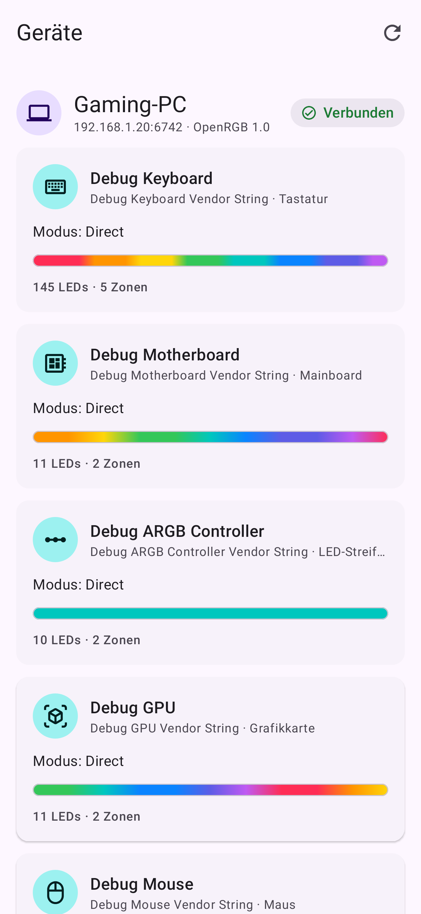 | 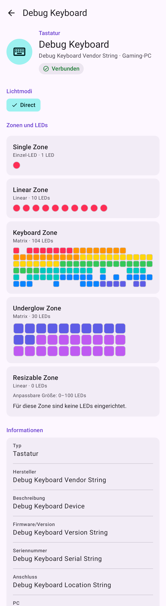 | 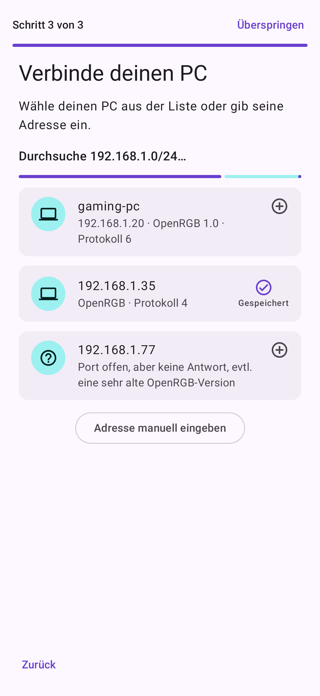 | 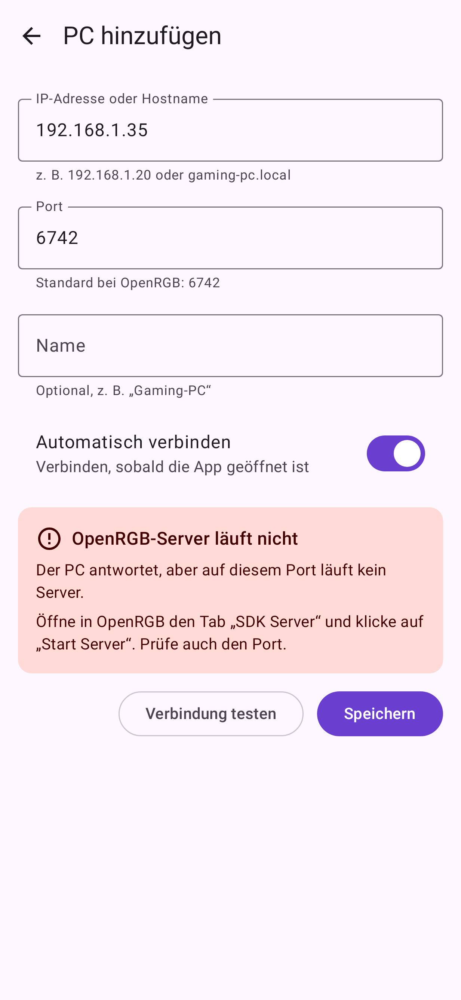 |

| Color control | Hardware mode |
|---|---|
| 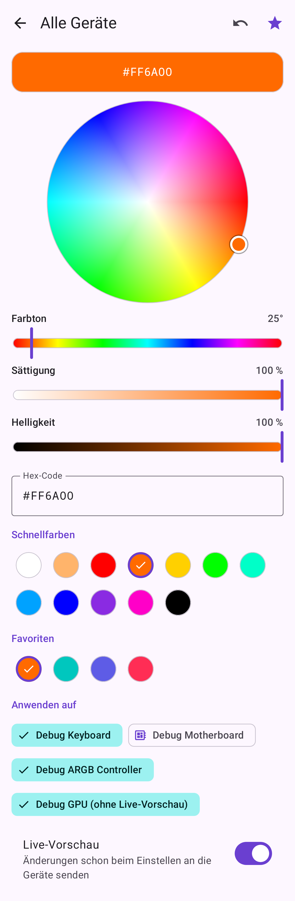 | 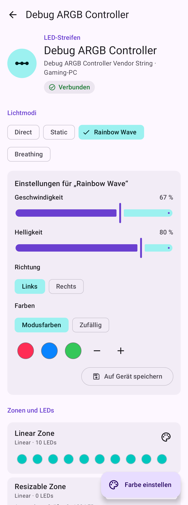 |

| Profiles | Profile editor | Animated profile |
|---|---|---|
| 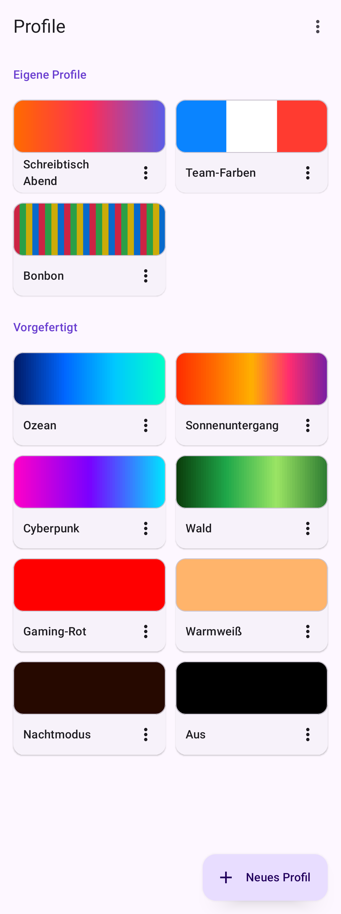 | 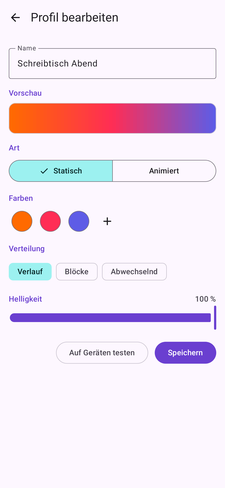 | 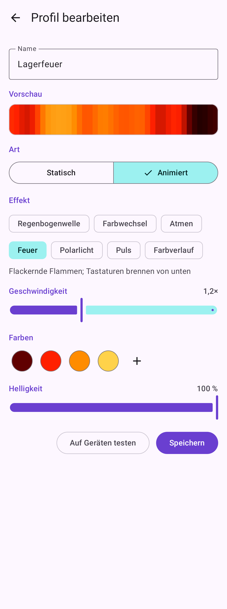 |

| Effects | Effect settings | Running effect in the device list |
|---|---|---|
| 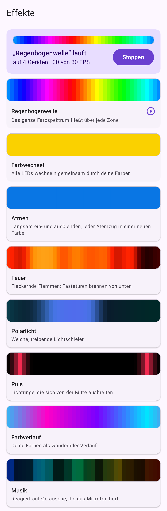 | 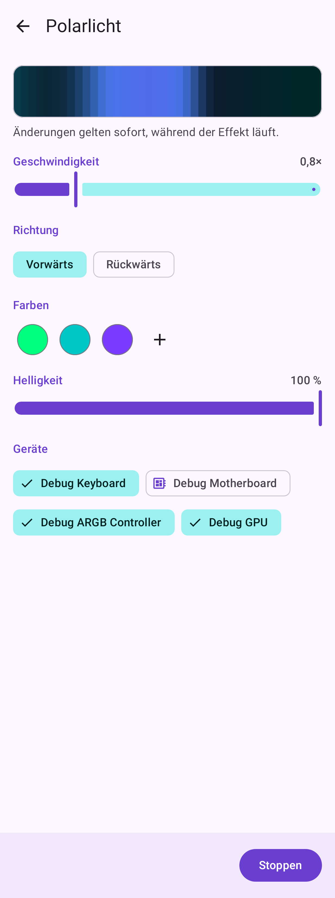 | 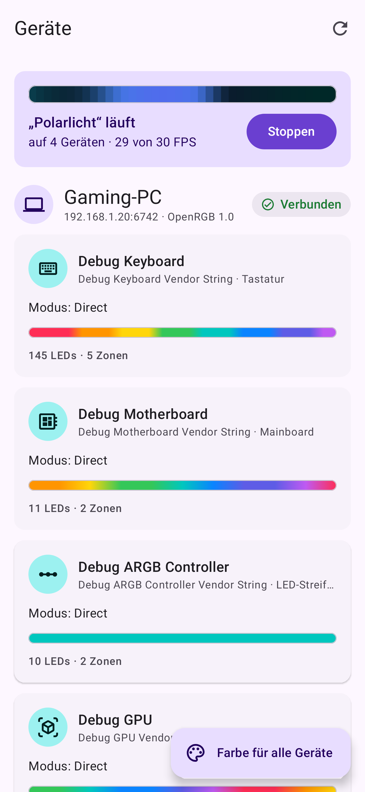 |

| Favorites (widget & tiles) | Schedules | Schedule editor | Large font (200 %) |
|---|---|---|---|
| 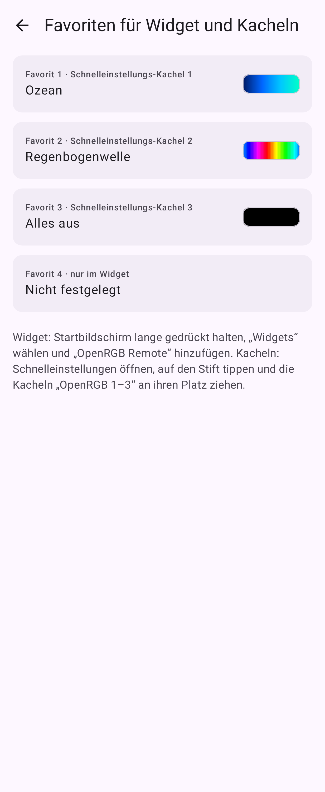 | 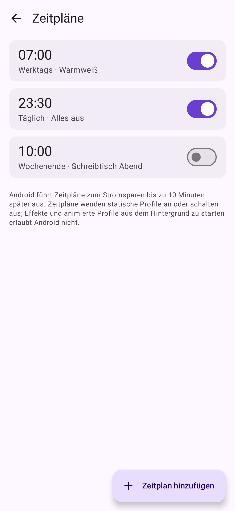 | 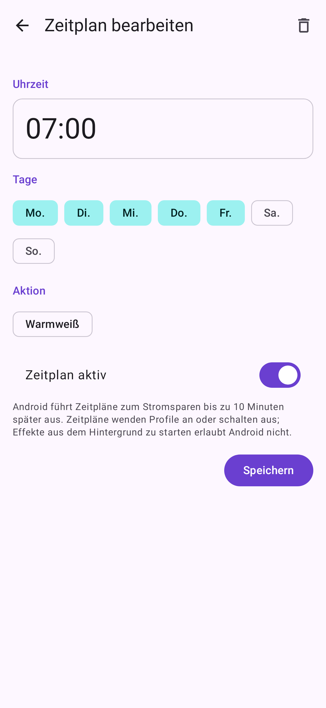 | 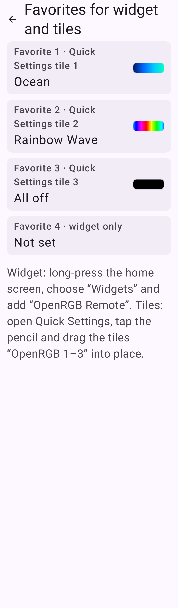 |

| SSH jump host | Confirm fingerprint |
|---|---|
| 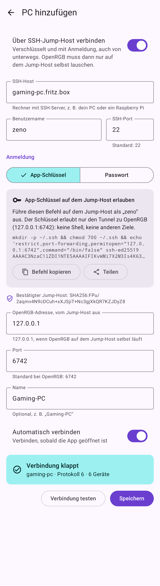 | 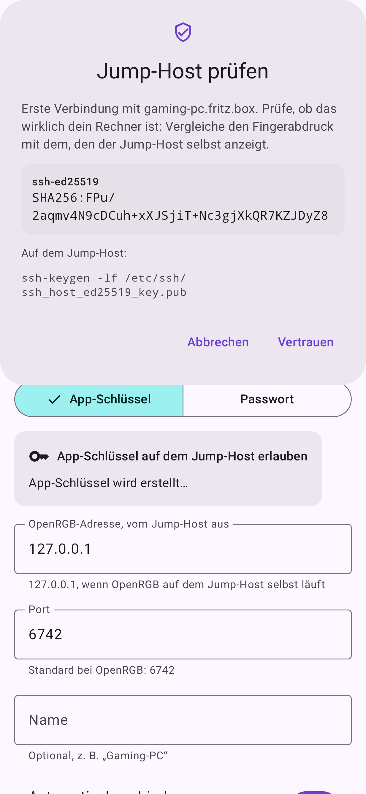 |

Tablet: 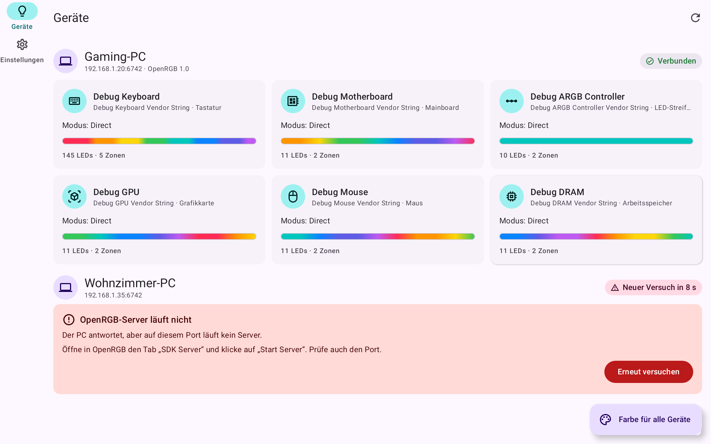 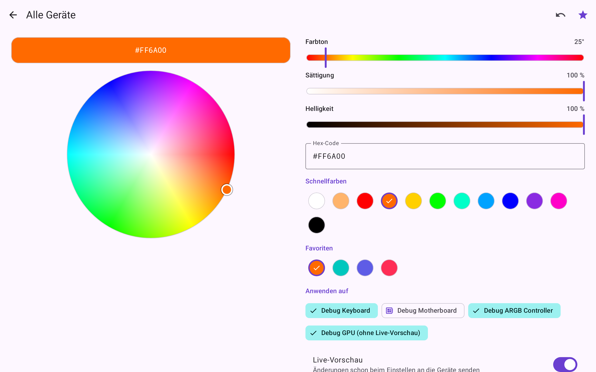

## Starting OpenRGB on the PC

OpenRGB 1.0 binds its SDK server to **127.0.0.1** unless told otherwise, so a phone cannot reach it.

* **With a desktop:** in OpenRGB's “SDK Server” tab set “Server Host” to `0.0.0.0` and press
  “Start Server”. `"Server": {"default_host": "0.0.0.0"}` in `~/.config/OpenRGB/OpenRGB.json` keeps it.
* **Without a display** (headless, over SSH): `openrgb --server --server-host 0.0.0.0`.
  Do not add `--startminimized`: it implies the GUI and aborts with
  “could not connect to display” / “Qt platform plugin xcb”.
* **Through an SSH jump host** (encrypted, with login, also from outside): plain `openrgb --server`
  is enough and safer, because the app connects to 127.0.0.1 on the jump host. In the app enable
  “Connect through an SSH jump host” when adding the PC.

As a service that starts with the user session (`~/.config/systemd/user/openrgb.service`):

```ini
[Unit]
Description=OpenRGB SDK server

[Service]
# Drop "--server-host 0.0.0.0" when the app connects through an SSH jump host.
ExecStart=/usr/bin/openrgb --server --server-host 0.0.0.0 --noautoconnect
Restart=on-failure

[Install]
WantedBy=default.target
```

`systemctl --user enable --now openrgb`; for a machine nobody logs in to, also
`loginctl enable-linger $USER`. Most devices need OpenRGB's udev rules (openrgb.org/udev).

## Build & test

Requirements: JDK 17+, Android SDK (platform 37) with `ANDROID_HOME` or `local.properties`.
The Gradle wrapper downloads Gradle 9.9 automatically.

```bash
./gradlew :app:assembleDebug                      # APK
./gradlew unitTests                               # all unit tests (debug variants)
./gradlew :app:lintDebug                          # lint (warnings are errors)
```

The screenshot tests write PNGs to `app/build/screenshots/`. Robolectric runs offline: its
Android runtime is resolved through Gradle (see `app/build.gradle.kts`).

Strings live in `tools/strings_app.py` (English + German) and are generated into
`app/src/main/res/values*/strings.xml` with `python3 tools/strings_app.py`. That way no key is ever
missing in one of the languages.

### Tests against a real OpenRGB server

```bash
# PC with OpenRGB: start the "SDK Server" (GUI) or headless:
openrgb --server --server-port 6742

OPENRGB_TEST_SERVER=192.168.1.20:6742 ./gradlew :openrgb-sdk:test
OPENRGB_TEST_SERVER=192.168.1.20:6742 ./gradlew :core:data:testDebugUnitTest
```

The second command includes `RealServerEndToEndTest`: the app's data layer applies profiles and
runs effects on the server, and a second client reads the colors back. It changes the lighting of
all devices on that server. Run the two commands one after the other, not in one Gradle call:
Gradle would run them in parallel, and the SDK test ends with a hardware rescan, which resets all
LEDs on an OpenRGB 1.0 server.

Through an SSH jump host, e.g. OpenRGB bound to 127.0.0.1 on the jump host:
`OPENRGB_TEST_SERVER=127.0.0.1:6742 OPENRGB_TEST_JUMP='user:password@pc.local:22' ./gradlew :core:data:testDebugUnitTest`
(optionally `OPENRGB_TEST_JUMP_FINGERPRINT` with the output of `ssh-keygen -lf`).

### CI and releases

`.github/workflows/build.yml` runs the unit tests and lint and builds both APKs on every push; they
are attached to the run as the `apks` artifact. Pushing a tag such as `v0.2.0` also creates a GitHub
release. For a stable release signature, add the secrets `RELEASE_KEYSTORE_BASE64`,
`RELEASE_KEYSTORE_PASSWORD`, `RELEASE_KEY_ALIAS` and `RELEASE_KEY_PASSWORD` (details in the workflow
file); without them the release APK is signed with a throwaway debug key. The debug app
("OpenRGB Debug", `dev.eno2.openrgbremote.debug`) installs next to the release.

The fixtures in `openrgb-sdk/src/testFixtures/resources/fixtures/openrgb-1.0` were captured with
`tools/capture_fixtures.py` from an OpenRGB 1.0 server with debug devices (instructions in the
script header).

## SDK example

```kotlin
val client = OpenRgbClient("192.168.1.20")
client.connect()                                   // negotiates protocol v0–6
val keyboard = client.devices.value.first { it.type == DeviceType.KEYBOARD }
keyboard.directModeIndex()?.let { client.updateMode(keyboard.id, it, keyboard.modes[it]) }
client.updateLeds(keyboard.id, IntArray(keyboard.ledCount) { 0xFF0040 })
client.close()
```

With automatic reconnect: `OpenRgbConnection(host, port, scope).start()`.

## License note

OpenRGB is an independent GPL project; this app is not affiliated with it. The protocol was
implemented from the public SDK documentation; no OpenRGB code is used.
